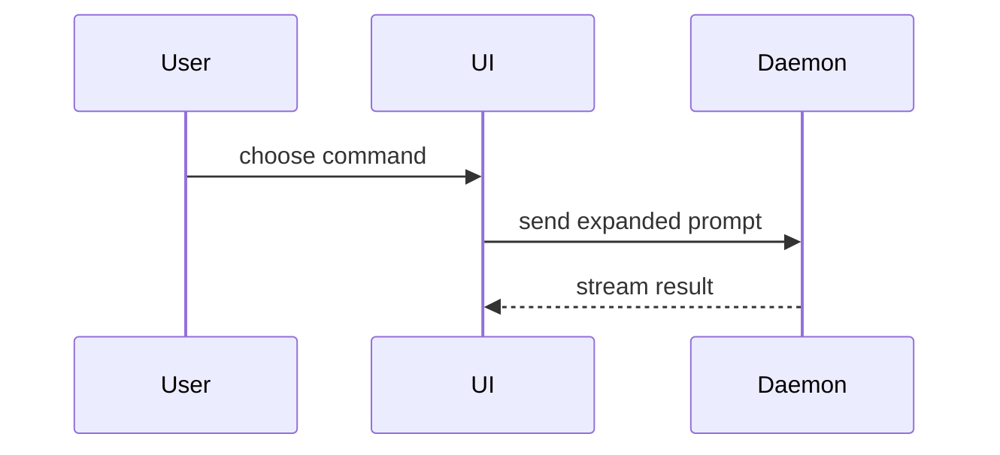

使用以下模板撰写 PR 正文：

```markdown
## Summary

<diagram, diff-sketch, or tree>

## Evidence

- **Before:** <screenshot/output/failing test run>
  **After:** <screenshot/output/passing test run>

## Merge Danger

**Door:** <one-way or two-way>

<optional: description>

**Blast Radius:** <one-word description>

<optional: potential ramifications of merge>
```

## 章节

省略一切开场白，正文保持简洁。使用 `GLOSSARY.md` 中用户领域的术语。

### 概述

选择能把要点讲清楚的最小视角。

- 用伪代码展示逻辑或算法：

```text
on(save)
  if content is unchanged
    return cached result
  write new content
  return fresh result
```

- 用调用树展示运行时控制流：

```text
submitForm
  createSession
    persistPrompt
    launchAgent
  navigateToSession
```

- 用组件树展示 UI 结构，包含关键的状态与模块边界：

```text
<SessionPage> (apps/example/src/routes/session.tsx)
  useSessionEvents()
  <SessionToolbar>
    <RunSkillButton> (packages/ui)
```

- 用浅层文件树展示文件职责或大规模重构：

```text
src/
├── commands/       # parses user actions
├── sessions/       # owns session state
└── transport/      # sends API requests
```

- 用 Mermaid 展示组件交互、控制流或数据流：



- 当重点在于改动内容、而周边结构已存在时，使用 `diff`。差异的呈现形式要与主题匹配。

组件改动：

```diff
 <SessionPage>
   useSessionEvents()
   <SessionToolbar>
+    <RunSkillButton />
   <SessionTimeline>
+    <SkillResultCard />
```

文件布局改动：

```diff
 src/
 ├── commands/
+│   └── show-me.ts       # expands the slash command
 ├── sessions/
-└── transport.ts
+└── transport/
+    ├── client.ts
+    └── stream.ts
```

调用树或调用栈改动：

```diff
 submitForm
   createSession
     persistPrompt
+    expandSkillMention
     launchAgent
-  navigateToSession
+  navigateToSession
+    subscribeToEvents
```

状态或控制流改动：

```diff
 on(save)
-  write content
+  if content is unchanged
+    return cached result
+  write new content
+  invalidate cache
```

- 当大部分内容都是新增、省略上下文会掩盖归属或顺序，或用户需要可直接复制的目标结构时，展示完整代码块：

```ts
function expandSkill(command: string): string {
  const skillName = command.slice(1);
  return `use the ${skillName} skill`;
}
```

#### 指导原则

将每个图示放在它所支撑的简短文字旁边。只保留回答用户当前问题、或解决当前讨论点所需的调用、文件、props、状态与边界。

可以只用其中一种，也可以用几种；不太可能全部用上。自行判断，不要让用户应接不暇。

### 证据

证明改动有效的具体证据。展示改动前后的对比。

截图属于 S 级——前提是环境已就绪且改动是可视化的。

基于执行的证据属于 A 级：测试结果、控制台输出。用伪代码展示那条现在由失败转为通过的具体测试。

### 合并风险

说明这是单向门还是双向门。双向门可以退回，单向门则不能。回退成本低的 PR 风险更低。涉及破坏性操作或难以逆转的决策的改动属于单向门。

爆炸半径指本 PR 所引入改动的潜在影响或范围。考虑所有可能性，例如布局偏移、对消费方造成的破坏、移动端响应式问题等。
